# UX audit

What gets in the way of the people who use Firefighters today, ordered by impact, with the evidence, the cause and a concrete proposal for each problem. The vision that answers them is in [`direction.md`](direction.md). How the evidence was produced, and how to reproduce it, is in [`README.md`](README.md).

## How it was done

- The app ran locally on `main` (756d91e) with one realistic campaign (`pnpm seed:demo`): 6 collectors, 90 buyers, 240 bonds, 147 sales, 12 closed and 3 open settlements, 3 draws.
- `scripts/ux-walkthrough.ts` opened **62 screens** (52 staff screens, 9 of the portal, and the login) with the **5 roles**, at **375 px and 1280 px**, in **light and dark**: 896 captures, each measured (status, length, overflow, controls). Results in [`before/report.json`](before/report.json), 488 screenshots in [`before/`](before/).
- `scripts/ux-flows.ts` ran the **critical flows on a 375 px screen** as a person would, counting screens, taps, fields and choices: [`before/flows/flows.json`](before/flows/flows.json), with a screenshot per step.
- The source of each screen was read to find the cause.

What was not done: nobody from the station was observed using the app. Frequencies below are estimates from the business flows in `docs/`, and should be corrected by whoever knows the station's routine.

## Summary

The visual language merged in #145 to #148 is sound, and the three redesigned screens show it. The problems that remain are mostly about **getting to things and identifying them**, not about looks:

1. A payment, the most frequent operation, is recorded by picking a sale from a dropdown, and the list of payments does not say which bond each one belongs to.
2. Inside a campaign there is no navigation. On a phone the section links are below five screens of dashboard.
3. The bond record, where every claim starts, never names the buyer or the collector.
4. The collector portal is built from wide tables. On a phone the form to send a payment is cut off inside a table cell.
5. Real amounts and real row counts break things that pass with the two-row E2E fixtures: horizontal scroll at 375 px, records thirteen screens long.

Scores are frequency (1 to 5, how often someone meets it) times severity (1 to 5, from cosmetic to «money or a bond can be mixed up»).

| #   | Problem                                                                 | Who                  | Freq. | Sev. | Score |
| --- | ----------------------------------------------------------------------- | -------------------- | ----- | ---- | ----- |
| A1  | Recording a payment is slow and blind on a phone                        | Treasurer, operator  | 5     | 4    | 20    |
| A2  | No navigation inside a campaign                                         | Everyone             | 5     | 4    | 20    |
| A3  | The bond record does not say who has the bond or who bought it          | Everyone             | 5     | 4    | 20    |
| A4  | Payments in a settlement cannot be identified                           | Treasurer            | 4     | 5    | 20    |
| A5  | The portal does not work one-handed                                     | Collector            | 5     | 4    | 20    |
| A6  | Registering a sale loses the bond, and buyers are hard to find          | Operator             | 4     | 4    | 16    |
| A7  | Lists on a phone: filters first, columns cut, the page scrolls sideways | Everyone             | 4     | 3    | 12    |
| A8  | Rare and risky actions sit on the main surface; red means «normal»      | Treasurer, admin     | 3     | 4    | 12    |
| A9  | Treasurer and read-only see «Unknown collector» and «Unknown buyer»     | Treasurer, read-only | 4     | 3    | 12    |
| A10 | Words from how the system was built, and mixed money formats            | Everyone             | 5     | 2    | 10    |
| A11 | After signing in there is a dead end before the work                    | Everyone             | 5     | 2    | 10    |
| A12 | Records and reports are many screens long                               | Treasurer, admin     | 3     | 3    | 9     |
| A13 | Error pages are bare and in English                                     | Non-admin roles      | 2     | 4    | 8     |
| A14 | Dark mode looks like another product                                    | Phone users at night | 2     | 2    | 4     |
| A15 | Smaller things                                                          |                      |       |      |       |

## Critical flows, measured

Measured on a 375 px screen, signed in as admin (staff flows) and as the linked collector (portal). A «screen» is a page or a state the person has to read; «actions» are taps plus fields typed plus choices made.

| Flow                                                                   | Screens | Taps | Fields | Choices | Actions |
| ---------------------------------------------------------------------- | ------- | ---- | ------ | ------- | ------- |
| Search for a bond (campaign page → number → record)                    | 3       | 2    | 1      | 0       | 3       |
| Register a sale (existing buyer, in installments)                      | 5       | 3    | 1      | 3       | 7       |
| Open a settlement, record two payments, close it, print the note       | 8       | 7    | 0      | 5       | 12      |
| Deliver a range of bonds and print the note                            | 5       | 4    | 2      | 1       | 7       |
| Create a draw, generate and freeze the roster, load a winner, award it | 10      | 10   | 7      | 2       | 19      |
| Collector sends one payment from the portal                            | 7       | 6    | 0      | 0       | 6       |

The counts alone look reasonable. What they hide is where each flow can go wrong:

### Search for a bond

`Campaña → «Número de bono» → Buscar bono → list filtered → Ver ficha → record`

- The search is only on the campaign page. From any other screen it is: breadcrumb to the campaign, then search (two more screens).
- The result is a list with one row; the person has to tap «Ver ficha». An exact match could open the record.
- The record does not answer the question that prompted the search (A3).

### Register a sale

`Registrar venta → number → Buscar → pick the bond (radio) → buyer (dropdown) → Modalidad (dropdown) → Confirmar venta`

- **Trap:** searching for a buyer reloads the page and the bond that was found disappears, while the plan preview keeps showing an amount (A6).
- The buyer dropdown holds the first 30 of 90 buyers. Finding someone means the search above, which triggers the trap.
- A single match still has to be selected with a radio button.
- Creating a buyer is a second form of 8 fields inside the first.
- Decisions: which bond (1), which buyer (1), payment mode (1), first due date (when in installments).

### Record payments and close a settlement

`Abrir rendición → collector (dropdown) → Abrir → [sale (dropdown) → installment (checkbox) → Agregar pago] × N → Cerrar rendición → confirm → Imprimir`

- Each payment is 3 actions and the list of sales is a dropdown (14 sales for the collector in the measured run; hundreds in a real campaign).
- On a phone, seven stacked totals come before the form (2 screens of scroll), and the amount field of each installment is off-screen (A1).
- After adding, nothing on the list says which bond the payment was for (A4).
- Recording a payment starts from a button named «Abrir rendición». There is no «Registrar pago», and no way to start from a bond or a sale.
- If the collector already has an open settlement, «Abrir rendición» is the wrong door: the person has to go to Rendiciones and find it.
- The payment date cannot be set (it is always today; the portal form does have a date).

### Deliver bonds

`Entregar bonos → range from/to → Agregar → collector (dropdown) → Entregar y emitir remito → Imprimir`

- The clearest of the flows. The range and the barcode scan are right.
- The list of added bonds is one line per bond with a «Quitar» button each: 35 bonds are 35 lines before the submit button.
- The button does not say how many bonds or to whom.

### Draw: roster and winners

`Sorteos → Nuevo sorteo → 5 fields → Crear → Generar padrón → confirm checkbox → Congelar → Ganadores y premios → Configurar un premio → 2 fields → Crear premio → number → Validar → Registrar resolución`

- Long, but it happens once a month and each step is deliberate. The freeze confirmation and the bond stub are good.
- The path from the frozen roster to «Ganadores y premios» is a text link at the bottom of the page.
- «Registrar resolución» does not say what is being resolved (award or not).

### Collector portal

`/portal → campaign → Mis bonos → Por cobrar → bond link → Registrar cobro (disclosure) → Revisar y enviar → Enviar cobro`

- Six taps and seven screens to send one payment, and the working list is the fourth tab.
- With two campaigns (one of them a draft with nothing in it) the portal opens on a campaign picker.
- On the sale page the form is inside a table that scrolls sideways (A5).

## Problems

### A1. Recording a payment is slow and blind on a phone

| 375 px, open settlement                                                     | 375 px, a payment ready to add                                                            |
| --------------------------------------------------------------------------- | ----------------------------------------------------------------------------------------- |
| 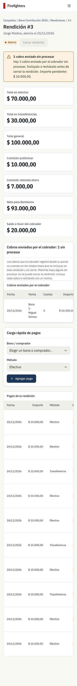 | 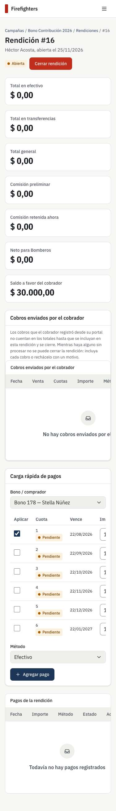 |

- **What happens.** The open settlement starts with seven totals as stacked cards. «Carga rápida de pagos» comes after two screens. A sale is chosen from a `<select>` labelled «Bono / comprador». The installments appear in a table whose «Importe» column, with the editable amount, is cut off at 375 px. An empty «Cobros enviados por el cobrador» card takes a full screen even when there is nothing in it.
- **Cause.** `settlements/[settlementId]/+page.svelte`: the open state keeps the pre-redesign `Stat` grid (#147 only redesigned the closed state); the form is a `Select` over `data.candidates`; the installments are a table inside a card.
- **Proposal.** The open settlement as in prototype 3: entry by bond number (matched in the browser against the same `candidates`), next installment pre-checked, method as two buttons, the live sheet beside the form (in a bottom bar on a phone), «Registrar pago» as a day's action. Same `?/add` action and fields.

### A2. No navigation inside a campaign

| 375 px, campaign page (sections at the very bottom)                          | 375 px, any inner screen                                       |
| ---------------------------------------------------------------------------- | -------------------------------------------------------------- |
| 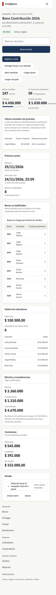 | 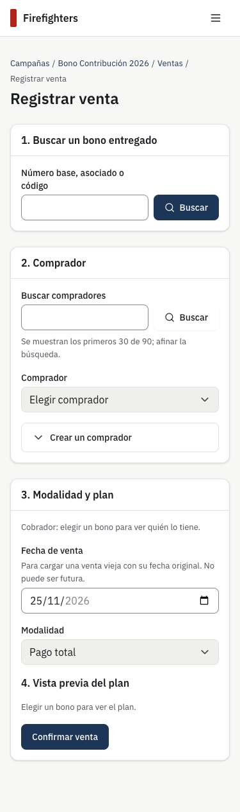 |

- **What happens.** The sections of a campaign (Bonos, Entregas, Ventas, Rendiciones, …) are links in a column of the campaign page. At 1280 px they sit beside the dashboard. At 375 px they render after it: the page is 5.2 screens long and the links are the last thing on it. Every other screen has only breadcrumbs, which wrap to two lines on a phone. Going from a sale to the settlements is: campaign, scroll to the bottom, Rendiciones.
- **Cause.** `campaigns/[id]/+page.svelte` owns the navigation as page content; `campaigns/+layout.svelte` renders only the top bar, whose links are «Campañas» and «Mi portal».
- **Proposal.** A campaign shell in the layout: left rail on desktop, bottom tab bar on a phone (Inicio, Bonos, Ventas, Rendiciones, Más), bond search in the top bar. See direction, proposal P2.

### A3. The bond record does not say who has the bond or who bought it

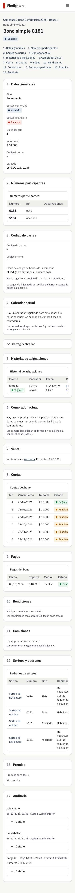

- **What happens.** The record of a sold bond has 14 numbered sections over 5.5 screens. Section 4, «Cobrador actual», reads «Hay un cobrador registrado para este bono; sus datos se muestran cuando existan las fichas de cobradores. Los cobradores llegan en la fase 5 y los bonos se les entregan en la fase 6.» Section 6 says the same about the buyer. Neither name appears anywhere on the record. Sections 10 and 11 say «Las rendiciones con cobradores llegan en la fase 8» and «Las comisiones se generan desde la fase 9». The audit section lists `sale.create` and `bond.deliver`.
- **Cause.** `BondPartySection.svelte` and `BondPendingSection.svelte` were written in phase 3, before collectors, buyers and sales existed, and were never replaced. The route already loads the active sale and the collectors.
- **Proposal.** Prototype 2: the stub, one sentence with the buyer, the collector and the debt, one next step by state, installments as the body, the rest collapsed. Needs the two names in the route's `load` (no SQL).

### A4. Payments in a settlement cannot be identified

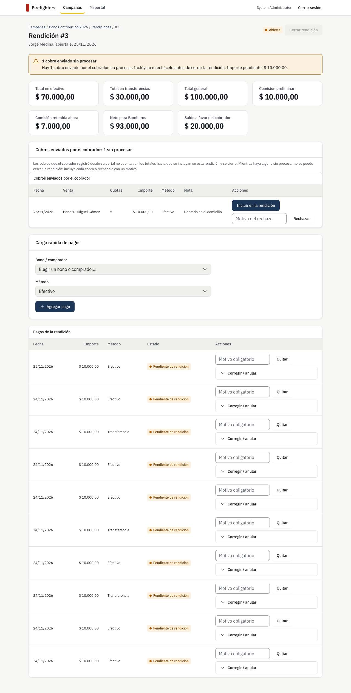

- **What happens.** «Pagos de la rendición» has the columns Fecha, Importe, Método, Estado and Acciones. Ten rows of «24/11/2026, $ 10.000,00, Efectivo» cannot be told apart, so a payment loaded on the wrong bond cannot be found by reading the list. The same table on the closed settlement has 171 controls for 21 payments.
- **Cause.** The table's columns do not include the sale; each row renders its remove form (a reason field and «Quitar») and a «Corregir / anular» disclosure with three forms.
- **Proposal.** Each row shows bond number, buyer, installments and method. Removing or correcting moves behind one control per row that opens a dialog (see A8).

### A5. The portal does not work one-handed

| «Por cobrar» at 375 px                                              | Sending a payment at 375 px                                                     |
| ------------------------------------------------------------------- | ------------------------------------------------------------------------------- |
| 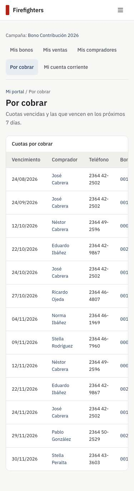 | 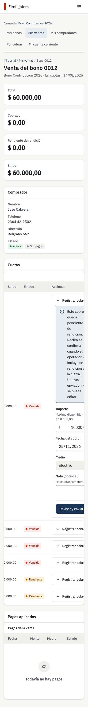 |

- **What happens.** «Por cobrar» is a seven-column table; at 375 px the bond number, the installment, the amount and the state are off-screen, and the phone number is text, not a link. On the sale page the «Registrar cobro» form opens inside the last cell of the installments table: the explanation wraps one word per line, and the amount field and «Revisar y enviar» are cut. Four stacked totals come first. The navigation is five links that wrap to two lines above every page.
- **Cause.** The portal pages reuse the desktop `Table`; `RegisterPaymentForm` is rendered in the table's actions column.
- **Proposal.** Prototype 4: «Por cobrar» as a list grouped by overdue and due this week, with «Llamar» and «Cobrar» on each item, the form in a sheet with everything pre-filled, and a bottom tab bar. Same routes and the same `?/registrar` action.

### A6. Registering a sale loses the bond, and buyers are hard to find

| Bond found and selected                                                       | After searching for the buyer                                                                            |
| ----------------------------------------------------------------------------- | -------------------------------------------------------------------------------------------------------- |
| 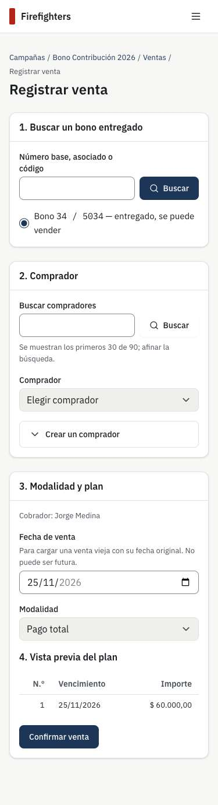 | 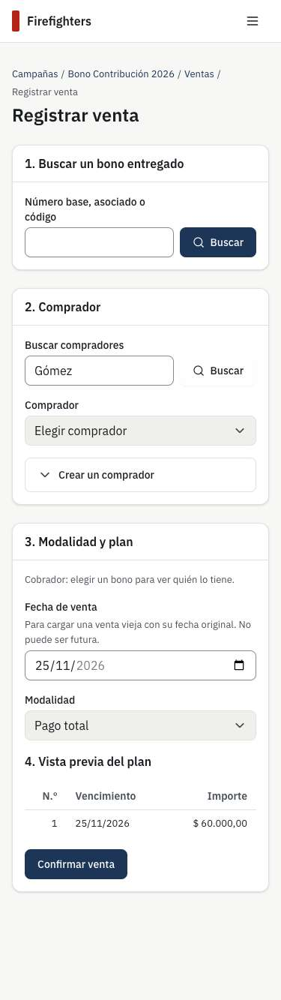 |

- **What happens.** After finding and selecting the bond, typing a name in «Buscar compradores» and pressing «Buscar» reloads the page. The found bond is gone and step 3 says «elegir un bono para ver quién lo tiene», yet the plan preview still shows a schedule. The buyer dropdown lists the first 30 of 90 buyers («Se muestran los primeros 30 de 90; afinar la búsqueda»), so with a real buyer list the search is unavoidable.
- **Cause.** `sales/new/+page.svelte`: the bond lookup lives in the `form` result of a POST action, and the buyer search is a GET form on the same page, which navigates and drops `form`.
- **Proposal.** Keep the found bond in page state and search buyers without leaving the page (type part of the name, matches listed under the field). Steps collapse to a line once answered. A single exact match is selected automatically. Entry from a bond record arrives with the bond already chosen.

### A7. Lists on a phone: filters first, columns cut, the page scrolls sideways

| Bonds                                                             | Sales                                                             | Settlements                                                                   |
| ----------------------------------------------------------------- | ----------------------------------------------------------------- | ----------------------------------------------------------------------------- |
| 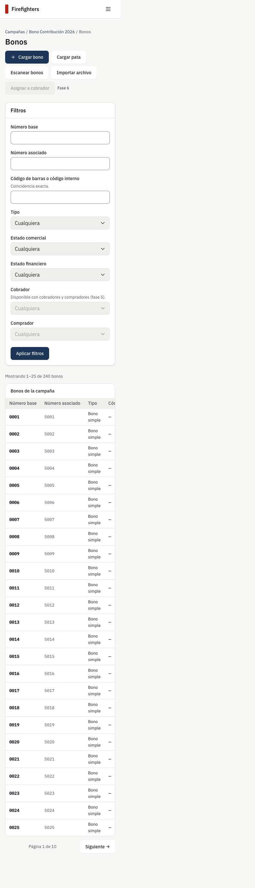 | 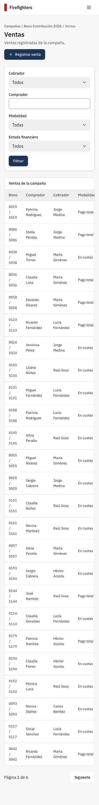 | 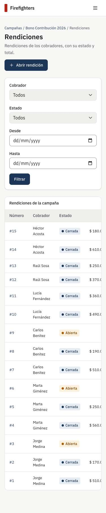 |

- **What happens.**
  - Filters fill the first screen before any row (8 fields on Bonos, two of them disabled).
  - Tables scroll sideways inside their card, so the columns that matter are hidden: state and value on bonds, amounts on settlements, state on sales.
  - **The bonds list scrolls the whole page sideways by 419 px at 375 px**, the campaign page by 26 px («pendiente $ 4.370.000») and the financial reports by 14 px (the export buttons). The settlement print overflows by 81 px.
  - The bonds list does not show the collector or the buyer. Open settlements are mixed with closed ones.
- **Cause.** Every list is the desktop `Table`. On the bonds list the table's scroll container sits in a wrapper that grows with it. The E2E sweep checks overflow with a two-bond campaign and four-digit amounts, where none of this shows.
- **Proposal.** The list pattern in the direction: search first, filters folded, two-line rows under 720 px, work in progress on top. Add a realistic-data case to the 375 px sweep.

### A8. Rare and risky actions sit on the main surface; red means «normal»

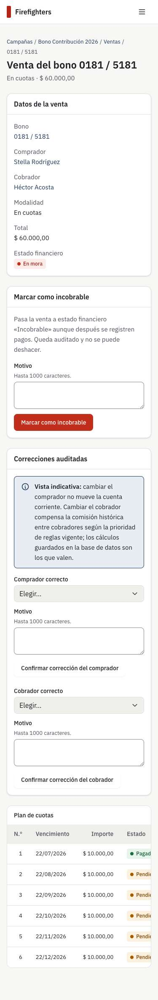

- **What happens.** On a sale, «Marcar como incobrable» (a red button with its reason field) and «Correcciones auditadas» (two forms) come before the installment plan, which is what people open the sale for. On an open settlement every payment row shows a «Motivo obligatorio» field with «Quitar». «Cerrar rendición», the normal end of the task, is a red danger button beside the title, and so is the confirm button in its dialog.
- **Cause.** Each action was added as a card or an inline form where its data lives; `variant="danger"` is used for «cannot be reopened» as well as for «destroys something».
- **Proposal.** Three levels (direction, Risky operations). Corrections and annulments go under «Corregir o anular» at the end of the record and open a dialog with the consequence and the reason. Closing a settlement is a primary button with its dialog (proposal P4).

### A9. Treasurer and read-only see «Unknown collector» and «Unknown buyer»

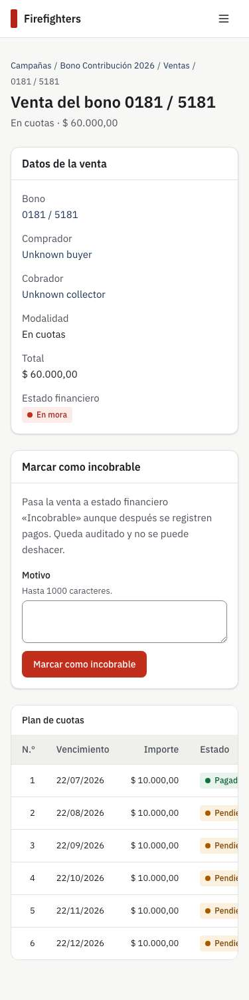

- **What happens.** Signed in as treasurer:
  - the sales list and each sale show «Unknown buyer» and «Unknown collector», as links that answer 403;
  - the settlements list and each settlement show «Unknown collector», and a closed settlement offers «Ver cuenta corriente de Unknown collector», which answers 404;
  - the operational reports do name the collectors, and each name is a link that answers 403;
  - 14 of the 52 staff screens answer 403, among them the collector and buyer lists.

  The treasurer is the person who takes each collector's money. Read-only has the same placeholders on sales and the same dead links on reports. The operator and the collector have none (a crawl of every link each role can see found 9 dead ends for the treasurer, 8 for read-only, 0 for the other two).

- **Cause.** Two things. The seeded treasurer and read-only roles have no `collector.view` or `buyer.view`, so the names cannot be read (a business decision, see below). And the screens fall back to an English placeholder and still render the link.
- **Proposal.** In the UI: a Spanish fallback («Sin acceso al comprador») with no link when the name cannot be read. For #50: decide whether the treasurer should read collectors and buyers (see Proposals that need business changes). The redesigned settlement depends on that answer: with today's permissions a treasurer could not see whose payment is whose.

### A10. Words from how the system was built, and mixed money formats

| Bonds list, «Fase 6»                                                | Campaign page, two formats in one card                                         |
| ------------------------------------------------------------------- | ------------------------------------------------------------------------------ |
| 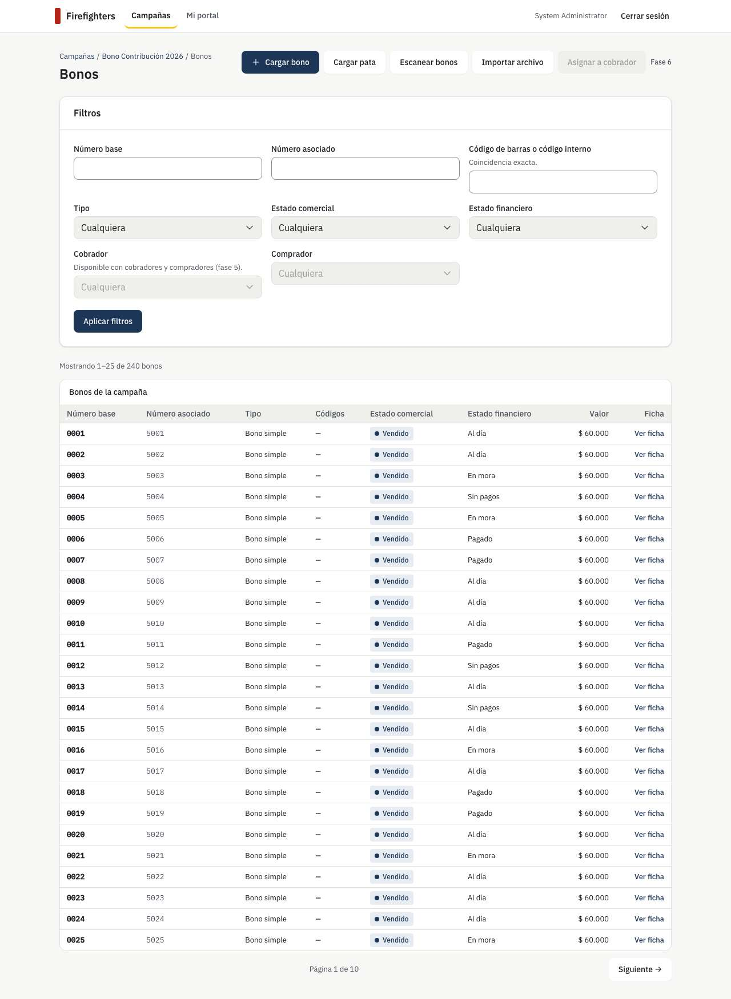 | 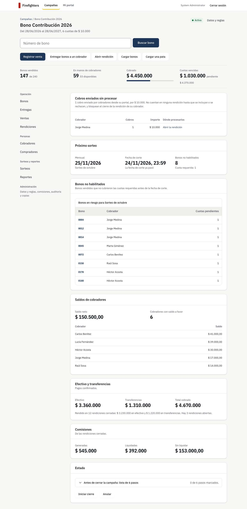 |

- **What happens.**
  - Development phases in the interface: a disabled «Asignar a cobrador» button with a «Fase 6» label and a filter «Disponible con cobradores y compradores (fase 5)» on the bonds list; ten such sentences on the bond record. Those phases shipped long ago.
  - The product is called «Firefighters» in the header and in every page title; the station's name appears only on printed documents.
  - The audit page lists action and entity codes (`payment.add`, `draw_roster`), does not say which bond or person each entry is about, and filters by «Id del usuario».
  - In one card: «Generadas $ 545.000», «Sin liquidar $ 153.000,00». «Saldo neto $ 150.500,00» next to «$ 4.450.000».
  - «Cuotas vencidas $ 1.030.000 pendiente $ 4.370.000»: two amounts whose relation is not stated.
  - Items joined with «·» in 13 files («Bono 1 · Miguel Gómez», «En cuotas · $ 60.000,00») and «#1 — Televisor» headings, both of which the approved direction says to avoid.
  - The fixture users are «Test Operator», «System Administrator».
- **Cause.** Placeholders that outlived their phase; `formatMoney` called with and without `decimals: 'always'` in the same block.
- **Proposal.** A copy pass per screen as it is redesigned, and the rules in the direction (whole pesos on screens, cents on documents; the station's words). Human names for audit actions. Proposal P1 for the name.

### A11. After signing in there is a dead end before the work

| Home after signing in                                   | Portal home with two campaigns                                      |
| ------------------------------------------------------- | ------------------------------------------------------------------- |
| 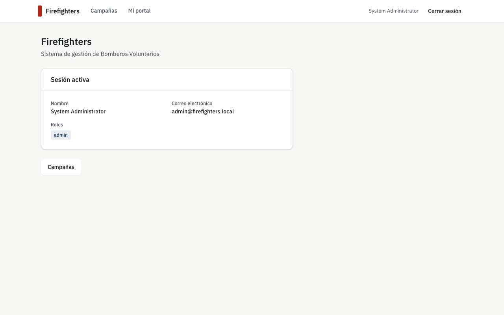 | 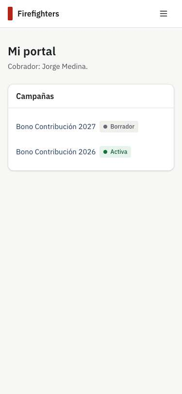 |

- **What happens.** Staff land on a «Sesión activa» card with their name, e-mail and role names (`admin`), and one button, «Campañas». Then the list, then the campaign: two screens with nothing to do, every session. A collector with a draft campaign in the system lands on a picker that offers the draft.
- **Cause.** `/` was the phase 1 session page. `/portal` lists every campaign the collector can see.
- **Proposal.** `/` goes to the active campaign when there is exactly one, otherwise to the list. The portal skips campaigns that are not active or closing when choosing where to land (part of proposal P5, since it changes the portal's `load`).

### A12. Records and reports are many screens long

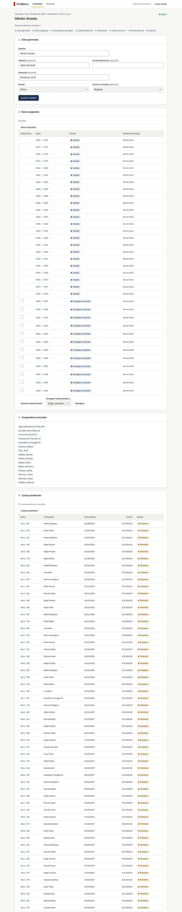

| Screen                                   | Length at 375 px | At 1280 px   |
| ---------------------------------------- | ---------------- | ------------ |
| Financial report with a collector chosen | 38.7 screens     | 26.8 screens |
| Collector record                         | 12.9             | 9.8          |
| Financial report                         | 9.9              | 6.9          |
| Operational reports                      | 5.7              | 4.2          |
| Bond record                              | 5.5              | 4.8          |
| Campaign page                            | 5.2              | 3.3          |
| Audit                                    | 5.2              | 3.6          |

- **What happens.** The collector record lists all 35 assigned bonds, then every pending installment (54 rows), with no paging, before reaching the settlements and the account. Reports render every table in full on one page.
- **Cause.** Records render complete lists inline; reports are one page with all their sections.
- **Proposal.** Records show the first 10 rows and link to the filtered list. Reports get one section per view (tabs), with totals first and the export beside them.

### A13. Error pages are bare and in English

- **What happens.** A 403 or a 404 renders the words «403 Forbidden» in the top-left corner of an empty page: no header, no way back, in English. Non-admin roles meet it often: 14 screens for the treasurer, 8 for the operator, 30 for read-only.
- **Cause.** There is no `+error.svelte`; SvelteKit's default page is shown.
- **Proposal.** An error page inside the shell that says what happened in Spanish and offers the way back (direction, Empty, loading and error states).

### A14. Dark mode looks like another product

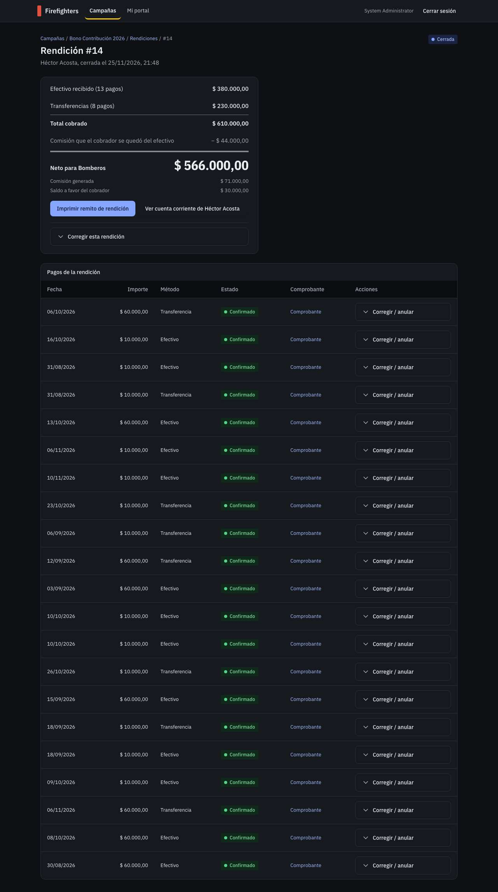

- **What happens.** In dark the action colour is a light periwinkle blue (`#86a6ff`) on near-black, with no trace of navy. #145 left this as a follow-up.
- **Proposal.** The navy-aligned dark palette in proposal P3, shown in the dark screenshots of prototype 3.

### A15. Smaller things

- A single search result still needs a tap on «Ver ficha»; a radio button has to be selected when only one bond matches.
- «Abrir rendición» for a collector who already has one open does not take the person to it.
- The delivery form lists added bonds one per line; a range of 35 pushes the submit button four screens down.
- The path from a frozen roster to the winners is a text link at the end of the page.
- Empty tables keep their header and an empty-state box that is cut at 375 px («No hay cobros enviados por el…»).
- The sale's installments show «Pendiente» for overdue ones while the sale says «En mora».

## What each role can reach

From `before/report.json` (light, 1280 px): how each screen visited with that role answered. Staff roles visit the 52 staff screens; the admin also opens two portal screens; the collector visits the 9 portal screens plus the home, the campaign list, «Nueva campaña» and the campaign page.

| Role      | 200 | 403 | 404 | Notes                                                                                                 |
| --------- | --- | --- | --- | ----------------------------------------------------------------------------------------------------- |
| Admin     | 53  | 0   | 1   | The 404 is the deliberate «not found» probe, which every staff role also gets.                        |
| Treasurer | 36  | 14  | 2   | No collectors, buyers, new sale, new delivery, bond loading or new draw. Ledger answers 404 (see A9). |
| Operator  | 43  | 8   | 1   | No commissions, financial reports, audit, ledger, new collector or new draw.                          |
| Read-only | 21  | 30  | 1   | Reaches the campaign, bonds, deliveries, sales, commissions, reports and backups.                     |
| Collector | 12  | 1   | 0   | The portal, plus the campaign list and the campaign page (it has `campaign.view`).                    |

The links on the campaign page are filtered by permission, so these roles do not see links to sections they cannot open. Links inside records and reports are not always filtered (A9).

## What works and should be kept

- **The cash sheet** of the closed settlement (#147): the best screen in the app. Its idiom should spread, not change.
- **The bond stub** on winners (#148): the one bold gesture, and it reads as a ticket from this station.
- **The top of the campaign page** (#146): bond search first, then the day's actions.
- **Confirmation dialogs that restate the numbers**: closing a settlement lists its totals; the portal's «¿Enviar el cobro de la cuota 3?» repeats the amount, method and date.
- **The roster freeze**: a warning that names the consequence, a checkbox, then the button.
- **Delivery by range and by barcode scan**, with Enter adding the bond.
- **The numbering preview** on the campaign's rules.
- **The voice**: infinitives on buttons, impersonal messages, no voseo, consistent glossary (`docs/copy.md`).
- **Accessibility floor**: the E2E sweep keeps axe clean in light and dark and controls at 44 px on every route. This audit found no axe regression.
- **Printable documents**: the delivery note and the certificates are clear and complete.
- **Permission-aware navigation** on the campaign page.

## Proposals that need business changes

Outside the redesign's limits. Santi answered them on 2026-11-26 (#50):

| #   | Question                                                                                                                   | Decision                                                                                    | Where it goes                       |
| --- | -------------------------------------------------------------------------------------------------------------------------- | ------------------------------------------------------------------------------------------- | ----------------------------------- |
| Q1  | Should the treasurer read collectors and buyers (`collector.view`, `buyer.view`)? Today they see «Unknown collector» (A9). | Yes.                                                                                        | #160                                |
| Q2  | The treasurer has `collector.ledger.view`, but the ledger linked from a closed settlement answers 404 (A9).                | Fix it.                                                                                     | #161                                |
| Q3  | Should the staff payment form have a payment date, like the portal's?                                                      | Yes.                                                                                        | #162                                |
| Q4  | Should a collector see campaigns that are not active in the portal (A11)?                                                  | Not drafts: active ones, and those in closing. There will usually be one campaign per year. | [`plan.md`](plan.md), the portal PR |

Also decided: read-only reads collector and buyer names too (part of #160), and the portal lists campaigns in closing as well as active ones. Still open: the backend proposals B1, B2, B4 and B5 in [`direction.md`](direction.md#proposals-that-need-backend-or-business-changes).
